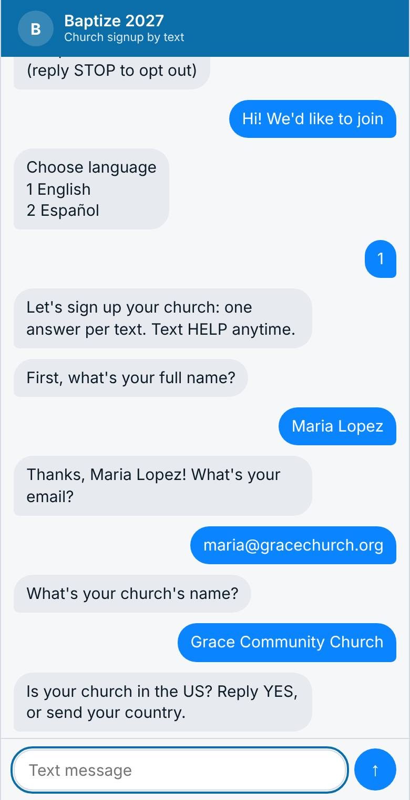
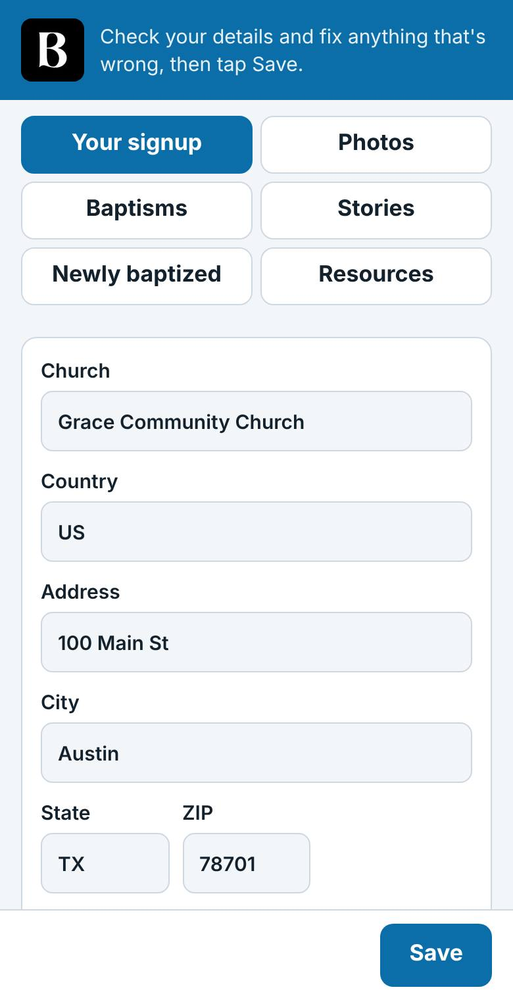
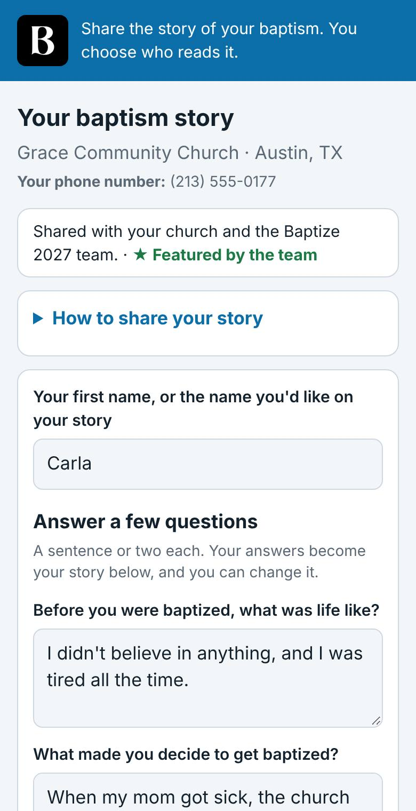
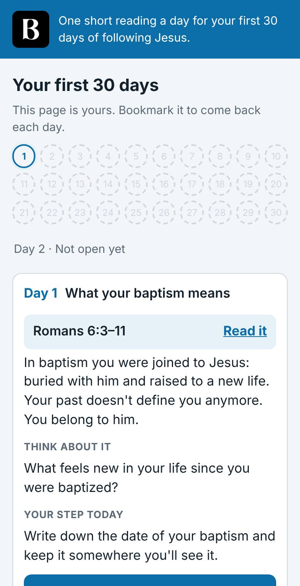
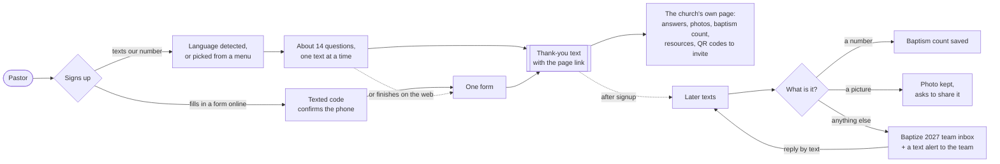
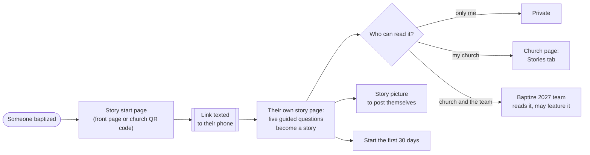
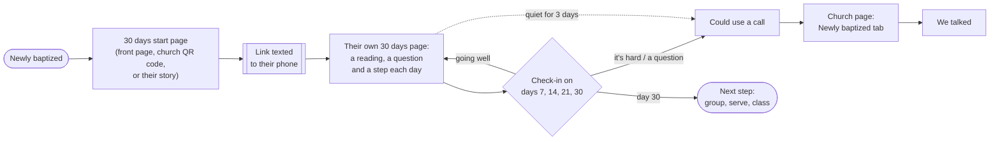

# Baptize 2027: sign up, share, grow

A simple way for churches to join **Baptize 2027**, and for the people they baptize to share their story and take their first steps of faith, from any phone, in their own language.

Churches sign up whichever way suits them: **by text message**, answering one short question at a time, or **on a mobile-friendly web page**. Stories and the first 30 days are mobile-friendly web pages too.

**Live site:** [baptize.app](https://baptize.app) · **Diagrams of each journey:** [How it works](#how-it-works) below · **Screenshots:** [baptize.app/features](https://baptize.app/features)

  
  
  
  

## Who it's for

**Churches.** A pastor signs up by simply texting our number and answering about 14 short questions, one text at a time, or by filling in one mobile-friendly form on the web. They get a private link to their church's own page, where they can change their answers, add photos of baptisms, report how many people they've baptized, and see how their newly baptized are doing.

**People who were baptized.** Anyone baptized can write their story with a few guided questions, choose who may read it, and make a picture of it to post themselves. They can also follow **the first 30 days**: a short reading, a question and one small step each day, with check-ins their church can see if they allow it.

**The Baptize 2027 team.** The team sees every signup, texts pastors back from the same number, reads the stories people chose to share with them, and edits the wording of every message.

## How it works

### Churches

A church signs up by text or on the web. Either way, the thank-you text links to the church's own page, which is the only login it needs.

### The baptized: sharing a story

Anyone baptized can write their story. A link texted to their phone is how they get back to it, and they choose who may read it.

### The newly baptized: the first 30 days

Online, except one text with their link. A new day opens each day, and check-ins reach their church if they allowed it.

## In 10 languages

English, Spanish, French, Portuguese, Chinese, Arabic, Hindi, Bengali, Russian and Urdu. A church that texts in its own language is answered in it, and every page has a language picker. The team writes in English and translates with one click.

## Privacy

- **No passwords.** Every church page, story and 30-day page has its own private link, sent by text. The pages aren't listed in search engines.
- **People choose.** A story is read only by the people its writer chooses. Photos are shared only if the church agrees. A church sees a newly baptized person's phone number only if they agree.
- **Deleting is for good.** Stories and photos can be deleted at any time.
- **We never post for anyone.** Story pictures are made on the person's own phone, for them to share.
- Texting works with numbers in the US and Canada.

## Status

A working proof of concept, built in October 2026. The gaps we know about and kept on purpose are in [docs/gaps.md](docs/gaps.md).

## For developers

- [docs/setup.md](docs/setup.md): how it's built, settings, voip.ms setup and running it locally
- [docs/features/](docs/features/): what each feature does, in detail
- [docs/workflows.md](docs/workflows.md): step-by-step diagrams of the three journeys
- [docs/schema.md](docs/schema.md): the database

## License and credits

MIT ([LICENSE](LICENSE)). QR codes are drawn with [qrcode-generator](https://github.com/kazuhikoarase/qrcode-generator) by Kazuhiko Arase (MIT license), copied unchanged to `public/js/qrcode.js`. "QR Code" is a registered trademark of DENSO WAVE INCORPORATED.
