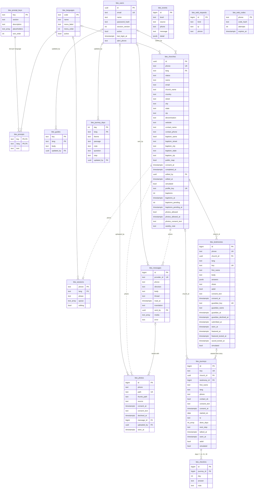

# Database schema

Supabase project `supabase-cobalt-saddle`, shared with other apps: everything of ours is prefixed `btw_`. Read from the live database on 2026-10-26 (after migration `20261025180000`).

- **Full DDL:** [`supabase/schema.sql`](../supabase/schema.sql) (reference only; the migrations in `supabase/migrations/` are the source of truth).
- **Access:** row level security is on for every table with no policies, so only the service role key, used server-side, reaches the data. The pages never talk to Supabase directly.
- **Storage:** photos live in the private bucket `btw-photos` (another app owns `photos`), reached through signed links.
- **`updated_at`** is set by the trigger function `btw_set_updated_at()` on users, languages, prompts, churches, sessions, testimonies, guides, journeys and journey days.

## Diagram

Solid lines are foreign keys. Dashed lines are joins by phone number (`+1XXXXXXXXXX`) with no foreign key: a church's session, texts and photos all share its `phone`.

## Tables

| Table | Holds | Feature doc |
|---|---|---|
| `btw_churches` | One signup per phone: every answer, status, the `/p/<key>` link, baptism count, photo choice, weekly note, who last edited it | [sms-signup](features/sms-signup.md), [pastor-page](features/pastor-page.md) |
| `btw_sessions` | Where each phone is in the text conversation: phase, language, questions left, editing | [sms-signup](features/sms-signup.md) |
| `btw_messages` | Every text in and out, in the `signup` or `team` thread, with read state, English translation, sender, MMS links and send error | [team-messages](features/team-messages.md) |
| `btw_photos` | Church photos in the `btw-photos` bucket: paths, where they came from, permission | [photos](features/photos.md) |
| `btw_events` | The Log panel: errors, warnings and info | [admin](features/admin.md#log-panel) |
| `btw_users` | /admin logins (scrypt hashes; removed users stay with `active = false`) and alert phones | [admin](features/admin.md#users) |
| `btw_languages` | The 10 languages: on/off, menu label and order | [prompts-and-languages](features/prompts-and-languages.md) |
| `btw_prompt_keys` | One row per message: description and the `{placeholders}` it must keep | [prompts-and-languages](features/prompts-and-languages.md) |
| `btw_prompts` | Each message's text in each language (more than 1000 rows: read with `dbAll()`) | [prompts-and-languages](features/prompts-and-languages.md) |
| `btw_guides` | Longer per-language texts: `testimony` (advice), `story_examples`, `bible_url`, `features` | [testimonies](features/testimonies.md), [first-30-days](features/first-30-days.md), [front-page](features/front-page.md) |
| `btw_web_requests` | One row per web request that may send a text, for rate limits and the daily cap (IP as a salted hash) | [web-signup](features/web-signup.md#spam-protection) |
| `btw_web_codes` | The 6-digit signup code per phone (salted hash, expiry, tries) | [web-signup](features/web-signup.md#spam-protection) |
| `btw_testimonies` | One story per phone: answers, story, who may read it, parent's OK, team read/featured | [testimonies](features/testimonies.md) |
| `btw_journeys` | One person's first 30 days: church, start date and time zone, days done, consent, contact, next step | [first-30-days](features/first-30-days.md) |
| `btw_checkins` | Check-ins on days 7, 14, 21 and 30 | [first-30-days](features/first-30-days.md) |
| `btw_journey_days` | The 30 days' content per language | [first-30-days](features/first-30-days.md) |

## Allowed values (check constraints)

| Column | Values |
|---|---|
| `btw_churches.status` | `in_progress`, `complete`, `opted_out` |
| `btw_sessions.phase` | `lang`, `collect`, `summary` (no longer used), `done`, `stopped` |
| `btw_messages.direction` | `in`, `out` |
| `btw_messages.thread` | `signup`, `team` |
| `btw_photos.source` | `web`, `sms`, `admin` |
| `btw_events.level` | `error`, `warning`, `info` |
| `btw_prompt_keys.section` | `system`, `fields`, `summary`, `keywords` |
| `btw_web_requests.kind` | `code`, `link`, `welcome`, `bot`, `story`, `journey`, `journey_link`, `guardian`, `story_saved` (a new kind needs a migration; see `CLAUDE.md`) |
| `btw_testimonies.share` | `me`, `church`, `baptize` |
| `btw_journeys.next_step` | `group`, `serve`, `class`, `unsure` |
| `btw_checkins.day` / `answer` | `7`, `14`, `21`, `30` / `good`, `hard`, `question` |
| `btw_journey_days.day` | 1 to 30 |

## Things to know

- **Phone is the real key** for the signup side: `btw_churches.phone` is unique, and sessions, messages, photos, events, web requests and codes all use the same `+1XXXXXXXXXX` form without a foreign key. Deleting a conversation in /admin removes its session, answers, texts, photos and logged problems.
- **Simulations and samples** are flagged with `simulated` on churches, testimonies and journeys; they're never texted.
- **Links are keys:** `btw_churches.profile_key` (`/p/`), `btw_testimonies.key` (`/s/`) and `guardian_key` (`/g/`), `btw_journeys.key` (`/j/`). Each is the only login to its page.
- **Deleting a church** leaves its stories and journeys in place with `church_id` set to null; deleting a journey deletes its check-ins.
