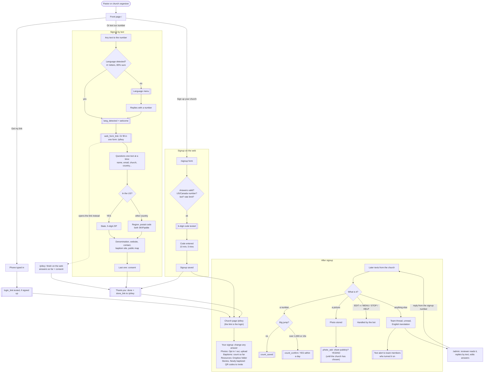
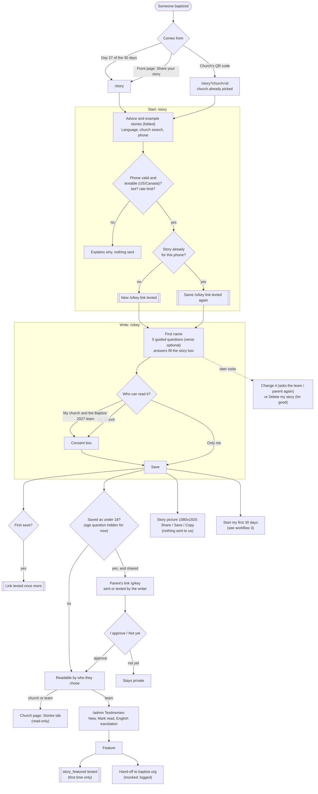
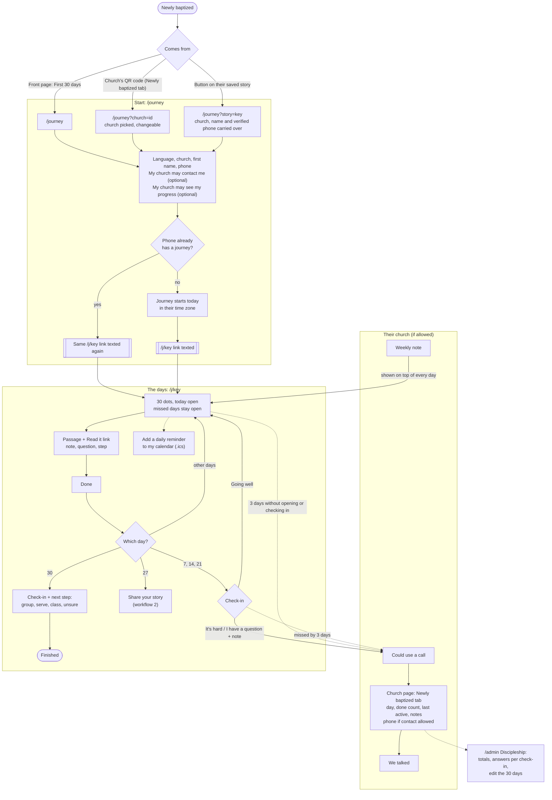

# Workflows

The site's three journeys, from the front page (`/`) on. The details behind each step are in `docs/features/`. GitHub renders these diagrams; elsewhere, paste a block into https://mermaid.live.

1. [Churches](#1-churches): sign up, then keep their page up to date
2. [The baptized: sharing a story](#2-the-baptized-sharing-a-story)
3. [The newly baptized: the first 30 days](#3-the-newly-baptized-the-first-30-days)

## 1. Churches

A church signs up by text or on the web; either way it ends with a thank-you text that links to the church's own page. Details: [sms-signup](features/sms-signup.md), [web-signup](features/web-signup.md), [pastor-page](features/pastor-page.md), [photos](features/photos.md), [baptism-counts](features/baptism-counts.md), [team-messages](features/team-messages.md).

## 2. The baptized: sharing a story

Anyone baptized can write their story. A texted link proves the phone, and the writer chooses who may read it. Details: [testimonies](features/testimonies.md).

## 3. The newly baptized: the first 30 days

Online only, except one text carrying their link. A day opens each calendar day; check-ins reach their church if they allowed it. Details: [first-30-days](features/first-30-days.md).

